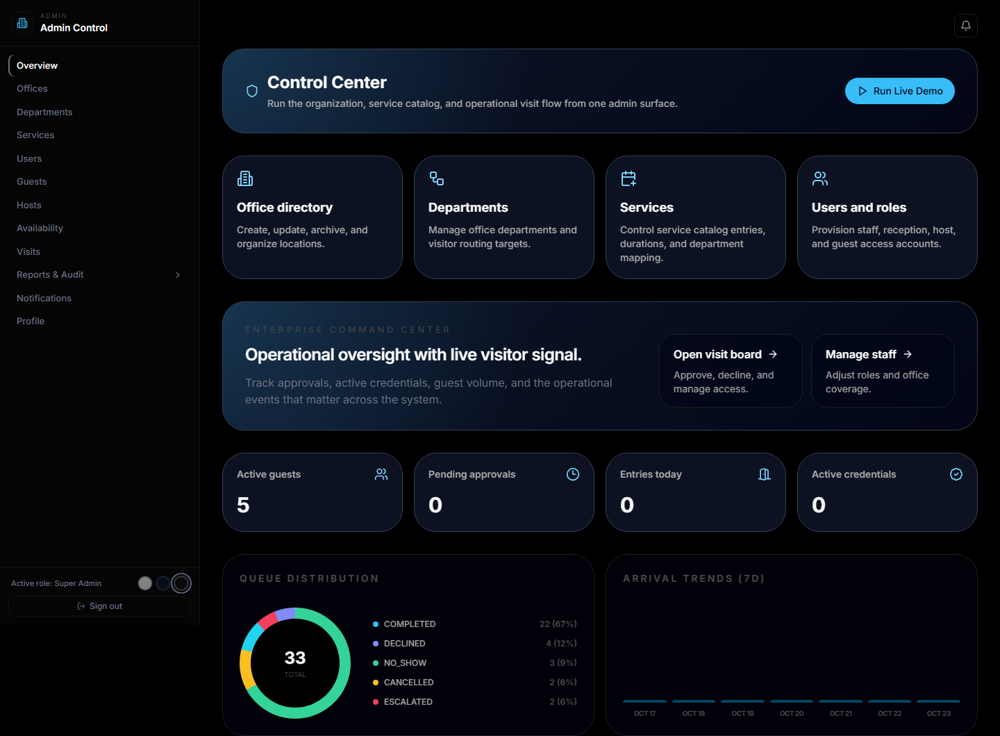
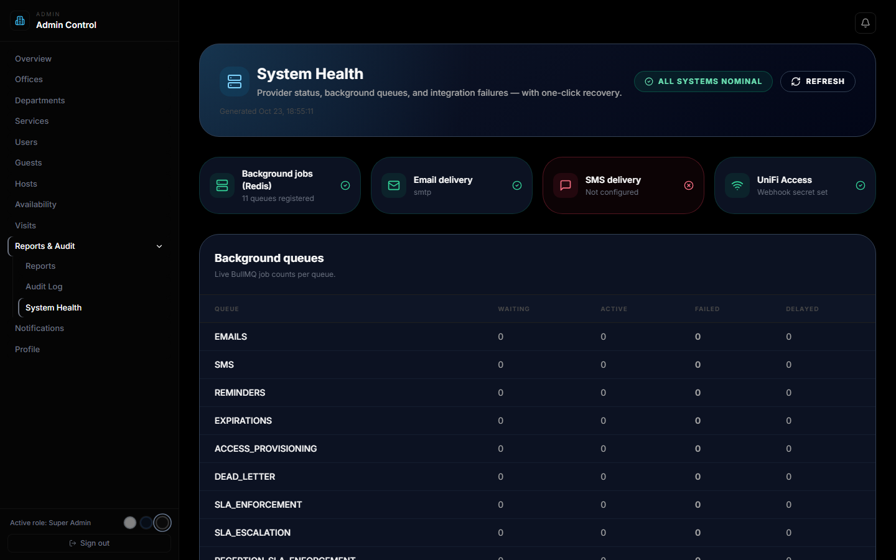
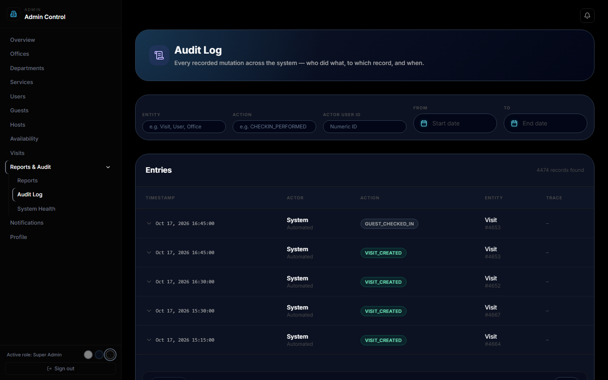
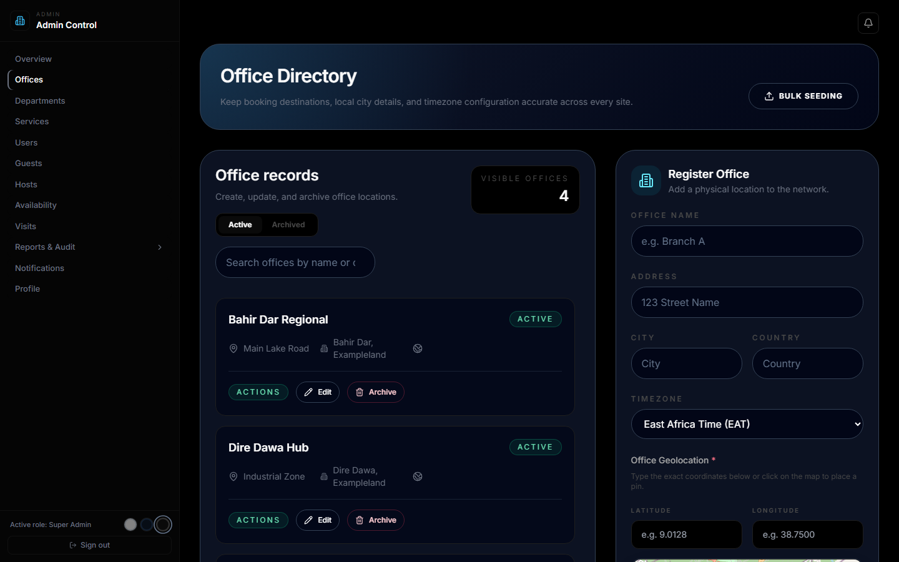
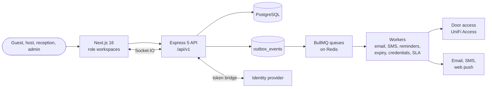

# Guest Management Platform (GMS)

A visitor and access-management platform for multi-office organisations. Guests request visits, hosts and reception approve and manage them, and door access, QR and PIN credentials, notifications and an audit trail are coordinated around each visit.

> **This is the public showcase.** It holds the write-up, screenshots and a live demo. The source code is private; see [Source access](#source-access).

| | |
|---|---|
| **What it is** | Visitor management with approvals, escalation, door-access credentials and real-time reception tools |
| **Stack** | TypeScript, Express 5, Sequelize, PostgreSQL, Next.js 16 (React 19), Redis and BullMQ, Socket.IO |
| **Quality** | 605 automated tests in 61 suites (test report generated and checked in CI), an OpenAPI coverage gate, Docker image smoke tests |
| **Live demo** | [Open it from the portfolio](https://dawitbkportfolio.vercel.app/#demos), which shows whether the demo server is online and has the sandbox login |
| **My role** | Architect and lead engineer: requirements, design, build, QA and UAT, go-live and training of the IT staff who run it |

## Try it live

1. Open the **demo access** card on the [portfolio](https://dawitbkportfolio.vercel.app/#demos) for the shared sandbox administrator login.
2. Sign in at the [identity portal](https://saas-portal-iota.vercel.app/sso/portal) and open **Guest Management**.
3. In the admin **Control Center**, press **Run Live Demo** to start a simulation of visitors arriving (press **Stop Demo** to end it), or open the operations queue to see approvals, escalations and credentials.

The demo runs on a server of my own, so it is sometimes offline (a restart, a power cut or maintenance). The portfolio shows its status and, when it is offline, how to reach me. The data is synthetic and comes from a visit simulator. Email and SMS providers and door hardware are not connected in the demo, and the System Health page says so.

## Screenshots

| | |
|---|---|
|  |  |
| **Control Center.** Office, department, service and user management, queue distribution and arrival trends from one admin surface. | **System Health.** Provider status, background queue depths and one-click recovery of failed events. |
|  |  |
| **Audit Log.** Every recorded change: who did what, to which record, and when, with filters. | **Office directory.** Offices with timezone and geolocation, create, edit and archive. |

## What it does

- **Guests.** Register, verify their account, book visits, receive a QR credential, respond to reschedule or reassignment proposals and leave feedback.
- **Hosts.** Own their availability, approve, reassign or reschedule visits, and are notified on arrival.
- **Reception.** Operate check-in, watch escalations and check people in manually when the door system is unavailable.
- **Administrators.** Manage users, offices, departments, services and hosts, import organisation data, and review operations and integration health.
- **Seven roles.** Guest, host and super host, reception and super reception, admin and super admin, with office-scoped permissions.
- **Approvals with escalation.** Service-level timers escalate unanswered requests, for hosts and for reception.
- **Door-access credentials.** UniFi Access integration for physical entry, with QR and PIN fallback.
- **ID scanning.** OCR of an ID document with a watchlist check, behind strict rate limits because it handles personal data.
- **Notifications.** Email, SMS and web push, queued and retried in the background.
- **Real time.** Authenticated Socket.IO rooms per user, office and visit keep reception and host screens current.
- **Reports.** Throughput, peak hours, approval and cancellation rates, ratings and on-time arrival, exportable to Excel and PDF.

## Architecture

### Design decisions

- **The visit is the central object.** Almost everything creates, validates, schedules, approves, checks in, provisions, notifies about or reports on a visit, so the code is organised around tracing a visit through its layers.
- **Transactional outbox.** Side effects (emails, door credentials, notifications) are written in the same database transaction as the change that causes them, then dispatched by workers. A crash can delay a notification but never lose one or send it for a change that rolled back.
- **A modular monolith with a separate worker.** Domain modules for visits, approvals, guests, hosts, credentials, notifications, offices, services and operations share one codebase, with background work in its own process.
- **Operational recovery is a feature.** System Health shows queue depths and lets an operator retry a failed outbox event or replay a failed door webhook without touching the database.
- **Graceful degradation.** Without Redis, rate limiting and caching fall back to memory with a warning; without door hardware, reception can check people in manually.
- **Single sign-on through a token bridge.** Staff sign in through the identity provider, which provisions the guest platform's own user and hands over a token it already trusts, so its own authentication did not have to change. Guests keep their own email and one-time-code flow outside SSO.
- **An API contract that is enforced.** CI fails if any live route and method is missing from the OpenAPI specification.

## Quality and operations

- 605 automated tests, with the status report generated from the test run and checked in CI so the documented count cannot drift.
- CI jobs: type-check, backend tests against a migrated database, frontend lint and production build, OpenAPI coverage, and Docker image builds.
- Taken through QA and user acceptance testing, then live on the organisation's own server behind a reverse proxy, with the IT staff trained to operate it.
- Releases are signed, preflight-checked and backed up first, with rollback.

## Source access

The code is private. If you are hiring, collaborating or reviewing, I am happy to walk through it on a call or give read-only access to the repository. Email [dawitbk01@gmail.com](mailto:dawitbk01@gmail.com) or open an issue titled "Source access request".

## Related showcases

- [Identity platform (SSO)](https://github.com/DawitBK/sso-showcase)
- [Document platform (DMS)](https://github.com/DawitBK/dms-showcase)
- [Portfolio](https://dawitbkportfolio.vercel.app) and [resume](https://dawitbkportfolio.vercel.app/Dawit-Bayou-Kassie-Resume.pdf)

## About this repository

The text and screenshots are from the live sandbox, taken on 23 October 2026. Organisations and people shown are fictional ("Example Corp"). See [LICENSE](LICENSE): the text and images may be viewed and linked to; the software they describe is not part of this repository and is not licensed by it.
